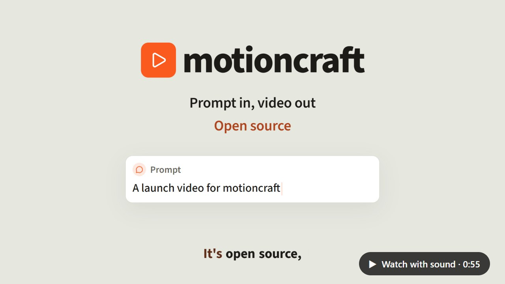
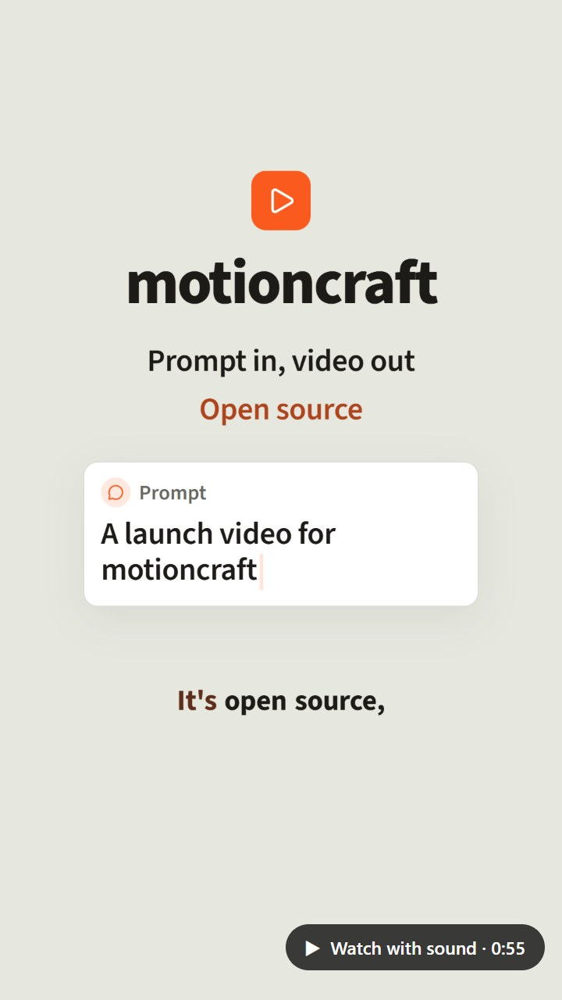

# motioncraft

An open-source agent skill that turns a prompt plus source material (a repo, notes,
a journal entry) into a short, narrated motion-graphics video: clean, code-drawn
headlines, cards, diagrams and code highlights, exported as MP4.

- **Shorts first:** 9:16 vertical, plus 16:9 widescreen.
- **Narrated by default** with a local, open text-to-speech model (Kokoro; one pinned download, then offline), and captions that light each word as it is spoken. `--no-narration` renders without a voice.
- **Checks its own work:** automatic layout checks, then the agent reviews still frames.
- **Local:** your machine, your installed browser, no accounts or cloud services.
- **Any agent:** Claude Code, GitHub Copilot CLI, OpenAI Codex.

## See it

Made with motioncraft: every frame drawn in code, narrated by a local voice, rendered on one machine. Click to watch with sound.

**Status: early development.** Nothing to use yet. The design is in
[`docs/design.md`](docs/design.md).

Built in public by [Nightshift](https://github.com/aakaashkapoor/nightshift), an
autonomous local coding loop, with an AI reviewer checking every PR.

License: [Apache-2.0](LICENSE).
